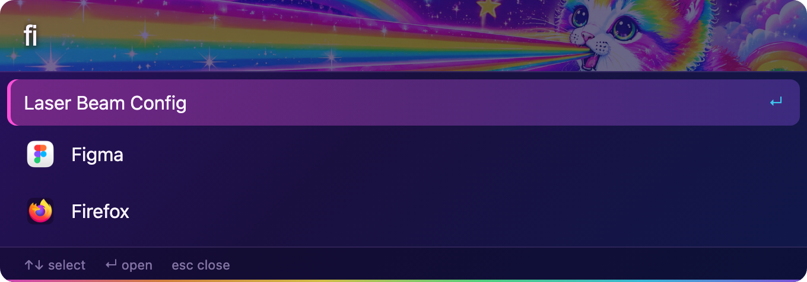
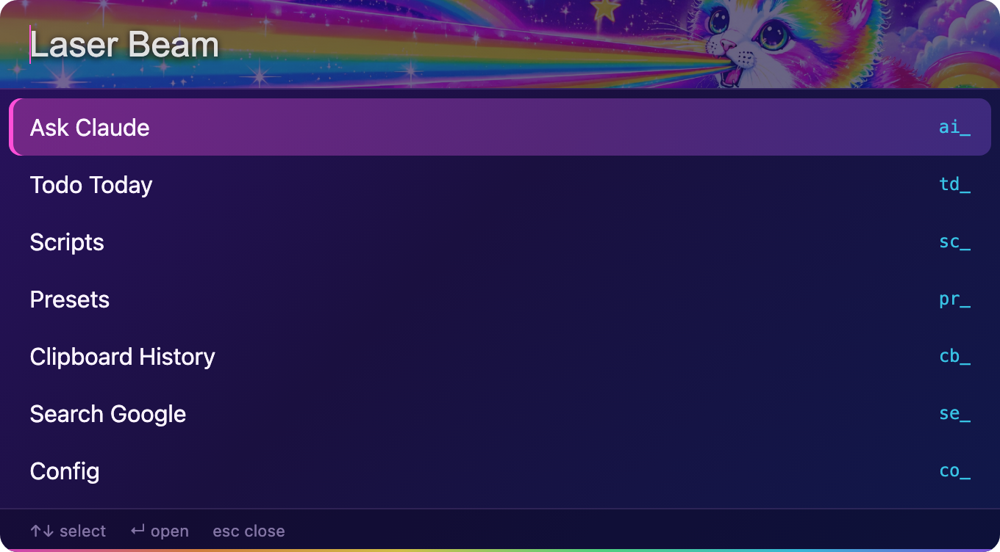
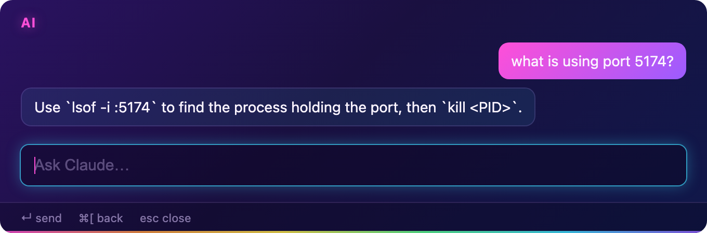
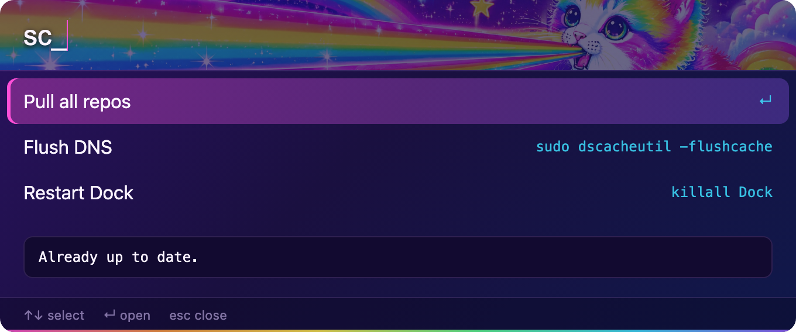
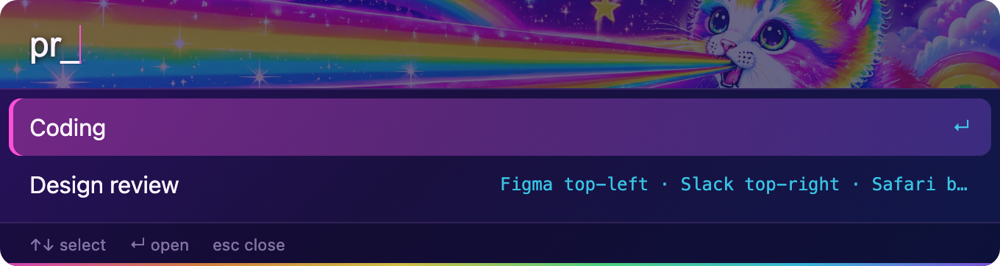
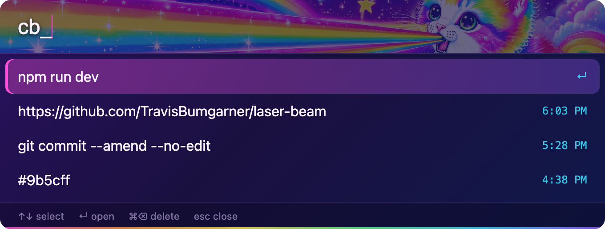

# Laser Beam

A Spotlight replacement for macOS. Press <kbd>⌥ Space</kbd> anywhere.



## Modes

Press <kbd>↓</kbd> on an empty bar to see every mode, or type its prefix.



| Prefix | Mode                                                                      |
| ------ | ------------------------------------------------------------------------- |
| `ai_`  | Ask Claude (uses your logged-in Claude Code CLI)                          |
| `td_`  | Add a task to [Todo Today](https://github.com/TravisBumgarner/Todo-Today) |
| `sc_`  | Run saved shell scripts                                                   |
| `pr_`  | Window layout presets                                                     |
| `cb_`  | Clipboard history                                                         |
| `se_`  | Search Google                                                             |
| `co_`  | Settings                                                                  |

### Ask Claude



### Scripts



### Window presets



### Clipboard history

Entries that password managers mark as concealed are never saved.



## Development

```sh
npm install
npm run dev
```

## Releasing

Bump `version` in `package.json` and merge to `main`. GitHub Actions signs, notarizes, and publishes the release.
